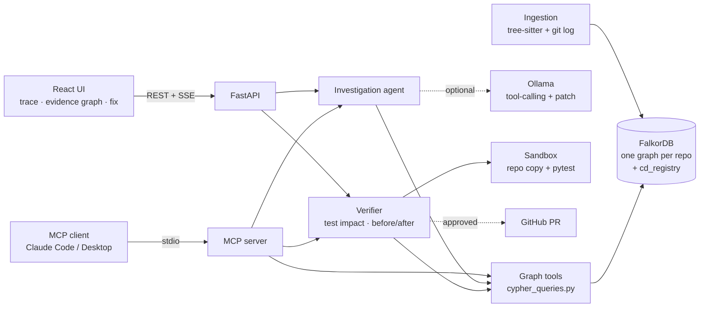

# Codebase Detective

**A bug-investigation agent that reasons over a FalkorDB code graph.** Paste a bug report (a stack trace helps) and
the agent walks the graph of your repository (functions, calls, tests, commits and the people who wrote them) to find
the root cause. It shows every hop as a Cypher query, then suggests a patch, reviewers, and what else the fix could break.
It remembers every investigation in the graph, so the next bug in the same area starts with that history.

Then it **closes the loop**. It proves the fix in a sandbox before anyone opens a pull request:
- The graph picks the tests that can reach the root cause (`TESTS` + `CALLS*0..3`).
- A regression test must **fail on the original code and pass with the fix**, and nothing that passed before may break.
- Imports the patch forgot are resolved through the graph.
- The proof is written back as `Fix` and `TestRun` nodes, and a verified fix confirms the root cause in memory.
- The pull request description is written from the graph: the issue it fixes, the team decision it restores, the
  before/after test table, and CODEOWNERS reviewers.
- A person approves it before it's opened. See [docs/verification.md](docs/verification.md).

It also knows the team around the code. Issues, pull requests, reviews, comments, teams and CODEOWNERS go into the
same graph, linked to the commits and functions they touched. The **company brain** answers "why is this code the way
it is" and "who should I ask", citing the issue, PR, review or decision behind every claim. It also flags **decisions
that may be out of date**, because the code they govern changed after they were made.

It also works before a bug is reported: the dashboard lists **risky recent changes** (functions changed in the last few
commits that no test calls, most-called first), with one click to **investigate** a change or **suggest a test** for it,
written from the function's callers, callees and the nearest existing tests in the graph.

Built for **Graph Hacks 2026** (WeMakeDevs × FalkorDB).

**Tracks entered:** Agents That Act on Connected Data (primary) · Agent Memory and Coordination · Company Brain

### 3-minute judge path

1. Connect `/demo/acme-shop`, then **New investigation → Fill demo bug**. Watch 22 graph steps stream in, each with
   its Cypher. Root cause: `process_refund`.
2. **Fix** tab: how the code got here (PR #12 reversed a decision Priya Raman recorded in PR #6), owners and reviewers.
3. **Verify & ship** tab: the graph selected 1 of 4 tests. Press **Run in sandbox**. The regression test **fails** on
   the original code and **passes** with the fix, the existing refund test still passes, and the agent added the
   `get_order` import the patch forgot, found through the graph. Status: **Fix verified**. Change the fix to
   `order["email"]` and run again: **Fix breaks other tests**.
4. The pull request draft: `Fixes #13`, the restored decision, the proof table, and @dana-kim, @priya-raman as
   reviewers. **Download .patch** applies with `git am`. **Open pull request** needs your approval (GitHub repos).
5. Back on the investigation, the root cause is now **confirmed** in memory. A differently worded second bug starts
   from it.

Proof from a real run: [`evidence/`](evidence/) (`verification-run.json`, `fix.patch`, `pull-request.md`, screenshot),
regenerated with `python scripts/capture_evidence.py`.

| What the brief asks for | Where it lives |
|---|---|
| Multi-hop reasoning | Callers/callees up to 3 hops, tests reached through calls, call paths, blast radius |
| Graph queries and algorithms as agent tools | 12 tools, all Cypher: PageRank hotspots, `shortestPath`, full-text search, BFS-style expansion |
| Tool selection through MCP | `backend/app/mcp_server.py` exposes the same tools (plus `investigate_bug`, `select_tests`, `verify_fix`, `run_cypher`) to any MCP client |
| Actions based on what the graph shows | Ranks suspects, picks a root cause, writes a patch, names reviewers from commit authorship, flags risky untested changes and drafts tests for them |
| Acting, and proving the action worked | Graph-selected tests + a reproducing regression test run before and after the patch in a sandbox; verdict `verified` / `regresses` / `not_reproduced` …; human-approved GitHub PR |
| Graph-driven test impact analysis | `(Test)-[:TESTS]->()-[:CALLS*0..3]->(root cause)` picks the only tests a change can break (1 of 4 on the demo) |
| Explainable results | Every step carries its Cypher; the **evidence graph** shows exactly the nodes and edges the agent visited |
| Memory across sessions | `Investigation` nodes linked to the functions they suspected or confirmed; recalled and scored by later runs. Fixes and their test runs are remembered too, and a verified fix confirms the root cause |
| Shared state between agents | The web agent and an MCP client (e.g. Claude Code) read and write the same investigation memory |
| Company brain: knowledge from docs, tickets and chats | Issues, PRs, reviews and comments from the GitHub API (or a tracker export) become `Issue`, `PullRequest`, `Comment` and `Decision` nodes |
| Who owns what, who knows what | CODEOWNERS → `(Team)-[:OWNS]->(File)`; authors and reviewers ranked per file; files only one person has changed |
| Tracing decisions to their source | `(Decision)-[:DECIDED_IN]->(Comment)-[:ON]->(PullRequest)-[:INCLUDES]->(Commit)-[:TOUCHED]->(Function)` |
| Keeping knowledge current | Idempotent `MERGE` sync that fetches only what changed since the last sync; decisions flagged when later commits change the code they govern |
| Answers with clear sources | Every sentence of a brain answer cites a numbered graph node, and the answer's subgraph and Cypher are shown |

## Why it needs a graph

"Why does refunding an unknown order crash?" isn't answered by any single record. The answer is a path:

```
(BugReport)-[:MENTIONS]->(handle_refund_request)-[:CALLS]->(process_refund)-[:CALLS]->(find_order)
(Person {Dana Kim})-[:AUTHORED]->(Commit "Refactor refund flow")-[:TOUCHED]->(process_refund)
(Test test_full_refund...)-[:TESTS]->(process_refund)        # happy path only
```

The same goes for *why* the code looks like that, and who knew it would break:

```
(Person {Priya Raman})-[:DECIDED]->(Decision "refund code always loads orders with get_order")
    -[:DECIDED_IN]->(Comment)-[:ON]->(PullRequest #6)-[:INCLUDES]->(Commit)-[:TOUCHED]->(process_refund)
(PullRequest #12 "simplify order lookup")-[:INCLUDES]->(Commit)-[:TOUCHED]->(process_refund)   # later: drift
(Person {Lee Okafor})-[:REVIEWED]->(PullRequest #12)          # not in @payments
(Team {payments})-[:OWNS]->(File shop/payments/refunds.py)
```

The agent follows those edges directly. If you remove FalkorDB, nothing is left: ingestion, every agent tool, scoring,
memory, the repository registry and the evidence graph are all Cypher over FalkorDB.

## Architecture



- **One graph per repository** (`repo_<uuid>`), plus a small `cd_registry` graph that lists repositories. This uses
  FalkorDB's multi-graph support: repos are fully isolated in one instance.
- **Ingestion** (`services/code_graph.py`, `services/parsing.py`): tree-sitter parses Python, JavaScript, TypeScript/TSX,
  Go and Java. Call sites are resolved to functions (same class → same file → imported file → unique name), tests are
  detected (`test_*`, `*.test.ts`, `it(...)` blocks, `*_test.go`, `@Test`), and `git log -U0` hunks are mapped onto
  function line spans. Everything is written in `UNWIND` batches.
- **Knowledge** (`services/knowledge.py`): public issues, pull requests, reviews and comments from the GitHub REST API
  (or a `.cd-knowledge.json` tracker export, used by the demo), plus CODEOWNERS. Closing keywords become `FIXES`,
  `#123` becomes `REFERENCES`, function names in text become `MENTIONS`, and sentences that record a decision
  ("Decision: …", "we agreed to …", "we won't support …") become `Decision` nodes. On GitHub only people who commit to
  the repository make decisions. Pull requests are joined to commits by merge sha, by the commits a merge brought in,
  or by commit subject.
- **Company brain** (`services/brain.py`): finds the functions and files a question names, runs `why_code`, `who_owns`
  and `search_knowledge`, and builds an answer in which every sentence cites a graph node. With an LLM it also writes
  a short summary from the same numbered sources (kept only if every citation is real), shown separately: on the demo a
  7B model misread which way the decision went, so the graph answer stays the answer.
- **Agent** (`services/agent.py`) works in two layers:
  1. A deterministic **graph sweep**: parse the report → locate entry points → expand along `CALLS` → gather evidence
     → rank. This always runs and needs no LLM.
  2. An optional **LLM loop** (Ollama, any tool-calling model): the model gets the ranked suspects and their source,
     picks graph tools itself to verify, and returns a verdict. A code model then writes a patch from the real source.
- **Verifier** (`services/verifier.py`, `services/sandbox.py`, `services/pull_request.py`) does the following:
  - selects tests from the graph,
  - drafts a regression test (with the team's decisions from the graph as the spec),
  - runs the tests before and after the patch in a sandbox copy,
  - repairs missing imports through the graph,
  - judges the result and writes `Fix`/`TestRun` nodes,
  - drafts the PR from the graph.

  Details and safety boundaries are in [docs/verification.md](docs/verification.md).

## Graph data model

### Nodes

| Label | Key properties | Notes |
|---|---|---|
| `Repository` | `id`, `name`, `url`, `ingested_at` | One per repo graph |
| `File` | `path`, `language`, `loc`, `is_test`, `module_code` | `module_code` = imports, constants and module state outside functions (used to write tests) |
| `Class` | `id`, `name`, `file_path`, `start_line`, `end_line` | Also Go structs/interfaces, Java interfaces/enums |
| `Function` | `id`, `name`, `qualified_name`, `file_path`, `start_line`, `end_line`, `signature`, `doc`, `code`, `complexity`, `tokens`, `in_test_file` | `tokens` = split identifier + path words, full-text indexed |
| `Test` | `id`, `name`, `file_path`, `start_line`, `end_line`, `code` | Test functions and `it()/test()` cases |
| `Commit` | `sha`, `message`, `timestamp` (ms), `author` | Last 300 commits |
| `Person` | `email`, `name` | Commit authors |
| `BugReport` | `id`, `title`, `description`, `status`, `created_at` | **Memory** |
| `Investigation` | `id`, `title`, `status`, `summary`, `keywords`, `mode`, `payload` | **Memory**: full trace stored as JSON |
| `Team` | `id`, `name` | **Knowledge**: from the tracker and CODEOWNERS (`@org/team`) |
| `Issue` | `id`, `number`, `title`, `body`, `state`, `url`, `created_ms`, `closed_ms`, `labels` | **Knowledge** |
| `PullRequest` | `id`, `number`, `title`, `body`, `state`, `url`, `created_ms`, `merged_ms` | **Knowledge** |
| `Comment` | `id`, `body`, `url`, `created_ms`, `path` | **Knowledge**: issue/PR comments, review comments and review summaries |
| `Decision` | `id`, `text`, `url`, `at_ms` | **Knowledge**: a sentence that records a decision, kept verbatim |
| `Fix` | `id`, `status`, `summary`, `created_at`, `payload` | **Action**: a patch the agent proposed, with its verdict (`verified`, `regresses`, …) |
| `TestRun` | `id`, `phase`, `passed`, `failed`, `errors`, `duration_ms`, `at` | **Action**: one sandbox run, on the original or the patched code |

### Relationships

| Type | Pattern | Properties |
|---|---|---|
| `CONTAINS` | `(Repository)->(File)`, `(File)->(Function\|Class\|Test)` | |
| `HAS_METHOD` | `(Class)->(Function)` | |
| `CALLS` | `(Function)->(Function)` | `line`, `resolution`, `count` |
| `IMPORTS` | `(File)->(File)` | |
| `TESTS` | `(Test)->(Function)` | `line` |
| `MODIFIES` | `(Commit)->(File)` | `added`, `removed` |
| `TOUCHED` | `(Commit)->(Function)` | a diff hunk overlapped the function |
| `AUTHORED` | `(Person)->(Commit)` | |
| `MENTIONS` | `(BugReport)->(Function)` | entry points found for the report |
| `INVESTIGATED_IN` | `(BugReport)->(Investigation)` | |
| `SUSPECTS` | `(Investigation)->(Function)` | `rank`, `score` |
| `CONFIRMED` | `(Investigation)->(Function)` | the real root cause: human feedback, or `source: 'verification'` when a fix was proven |
| `MEMBER_OF` | `(Person)->(Team)` | |
| `OWNS` | `(Team\|Person)->(File)` | `pattern` (the CODEOWNERS rule that matched, last match wins) |
| `OPENED` | `(Person)->(Issue\|PullRequest)` | |
| `REVIEWED` | `(Person)->(PullRequest)` | `state` (`APPROVED`, `CHANGES_REQUESTED`, …) |
| `WROTE` | `(Person)->(Comment)` | |
| `ON` | `(Comment)->(Issue\|PullRequest)` | |
| `ABOUT` | `(Comment)->(File)`, `(Decision)->(Function)` | review comment on a file; function named in the decision |
| `FIXES` | `(PullRequest)->(Issue)` | "Fixes #4", "closes #8" |
| `REFERENCES` | `(Issue\|PullRequest\|Comment)->(Issue\|PullRequest)` | any other `#123` |
| `MENTIONS` | `(Issue\|PullRequest\|Comment)->(Function)` | function names in the text (backticked, snake_case or camelCase) |
| `INCLUDES` | `(PullRequest)->(Commit)` | |
| `DECIDED_IN` | `(Decision)->(Issue\|PullRequest\|Comment)` | |
| `DECIDED` | `(Person)->(Decision)` | |
| `PROPOSED` | `(Investigation)->(Fix)` | |
| `PATCHES` | `(Fix)->(Function)` | |
| `VERIFIED_BY` | `(Fix)->(TestRun)` | `phase` (`original`, `patched`) |
| `RAN` | `(TestRun)->(Test)` | `outcome` (`passed`, `failed`, `error`, `skipped`) |
| `OPENED_AS` | `(Fix)->(PullRequest)` | the PR a person approved |

### Indexes

```cypher
CREATE INDEX FOR (f:Function) ON (f.id)
CREATE INDEX FOR (f:Function) ON (f.name)
CREATE INDEX FOR (f:File) ON (f.path)
CREATE INDEX FOR (c:Commit) ON (c.sha)
CREATE INDEX FOR (p:Person) ON (p.email)
CREATE FULLTEXT INDEX FOR (f:Function) ON (f.tokens, f.doc)
CREATE FULLTEXT INDEX FOR (i:Investigation) ON (i.keywords_text, i.title)
CREATE INDEX FOR (i:Issue) ON (i.number)          # also PullRequest.number, Comment.id, Decision.id, Team.name, Person.login
CREATE FULLTEXT INDEX FOR (i:Issue) ON (i.title, i.body)
CREATE FULLTEXT INDEX FOR (pr:PullRequest) ON (pr.title, pr.body)
CREATE FULLTEXT INDEX FOR (c:Comment) ON (c.body)
CREATE FULLTEXT INDEX FOR (d:Decision) ON (d.text)
```

## The Cypher the agent runs

All queries live in [`backend/app/services/cypher_queries.py`](backend/app/services/cypher_queries.py) and are
parameterized. The important ones:

**Locate: stack frame → function** (file suffix + name + line inside the body)
```cypher
MATCH (f:Function)
WHERE f.name = $name AND f.file_path ENDS WITH $file_suffix
  AND ($line < 0 OR (f.start_line <= $line AND f.end_line >= $line))
RETURN f.id AS id, f.qualified_name AS name, f.file_path AS file_path
```

**Locate: full-text over identifiers and docstrings**
```cypher
CALL db.idx.fulltext.queryNodes('Function', $q) YIELD node, score
WHERE node.in_test_file = false
RETURN node.id AS id, node.qualified_name AS name, score ORDER BY score DESC LIMIT $limit
```

**Multi-hop callers**
```cypher
MATCH p = (caller:Function)-[:CALLS*1..3]->(f:Function {id: $id})
WHERE length(p) <= $depth AND caller.id <> $id
WITH caller, min(length(p)) AS distance
RETURN caller.id AS id, caller.qualified_name AS name, distance ORDER BY distance
```

**Test coverage, direct and through callers**
```cypher
UNWIND $ids AS fid
MATCH (f:Function {id: fid})
OPTIONAL MATCH (t:Test)-[:TESTS]->(f)
OPTIONAL MATCH (ti:Test)-[:TESTS]->(:Function)-[:CALLS*1..2]->(f)
RETURN f.id AS id, collect(DISTINCT t.name) AS direct_tests, collect(DISTINCT ti.name) AS indirect_tests
```

**Who changed it recently**
```cypher
UNWIND $ids AS fid
MATCH (f:Function {id: fid})
OPTIONAL MATCH (p:Person)-[:AUTHORED]->(c:Commit)-[:TOUCHED]->(f)
WITH f, c, p ORDER BY c.timestamp DESC
RETURN f.id, collect({sha: c.sha, message: c.message, author: p.name})[0..$per_fn] AS commits
```

**Graph algorithm: PageRank over the call graph** (centrality factor + hotspots)
```cypher
CALL algo.pageRank('Function', 'CALLS') YIELD node, score
WITH collect({id: node.id, score: score}) AS all, max(score) AS top
UNWIND all AS row
WITH row, top WHERE row.id IN $ids
RETURN row.id AS id, row.score / top AS centrality
```

**Shortest call path**
```cypher
MATCH (a:Function {id: $src}), (b:Function {id: $dst})
WITH shortestPath((a)-[:CALLS*1..8]->(b)) AS p
RETURN [n IN nodes(p) | n.qualified_name] AS path
```

**Blast radius**
```cypher
MATCH (f:Function {id: $id})
OPTIONAL MATCH (caller:Function)-[:CALLS*1..4]->(f)
WITH f, collect(DISTINCT caller) AS callers
OPTIONAL MATCH (t:Test)-[:TESTS]->(x:Function) WHERE x = f OR x IN callers
RETURN size(callers) AS affected_functions, collect(DISTINCT t.name) AS covering_tests
```

**Expert routing (who knows this code)**
```cypher
MATCH (f:Function {id: $id})
OPTIONAL MATCH (p1:Person)-[:AUTHORED]->(:Commit)-[:TOUCHED]->(f)
OPTIONAL MATCH (p2:Person)-[:AUTHORED]->(:Commit)-[:MODIFIES]->(:File {path: f.file_path})
...
```

**Risky recent changes: untested functions touched by the last N commits, most-called first**
```cypher
MATCH (c:Commit)
WITH c ORDER BY c.timestamp DESC LIMIT $n
MATCH (p:Person)-[:AUTHORED]->(c)-[:TOUCHED]->(f:Function)
WHERE f.in_test_file = false
  AND NOT (:Test)-[:TESTS]->(f)
WITH f, collect(DISTINCT p.name) AS changed_by, collect(c.message) AS commits,
     max(c.timestamp) AS last_changed
OPTIONAL MATCH (caller:Function)-[:CALLS]->(f)
RETURN f.qualified_name AS function, f.file_path AS file,
       changed_by, commits, last_changed, count(DISTINCT caller) AS callers
ORDER BY callers DESC, last_changed DESC
```

**Test writing: a function, how it is used, and what it depends on**
```cypher
MATCH (file:File)-[:CONTAINS]->(f:Function {id: $id})
OPTIONAL MATCH (caller:Function)-[:CALLS]->(f)
WITH file, f, collect(DISTINCT caller) AS callers
OPTIONAL MATCH (f)-[:CALLS]->(callee:Function)
WITH file, f, callers, collect(DISTINCT callee) AS callees
RETURN f.code AS code, file.module_code AS module_code, size(callers) AS caller_count,
       [c IN callers | {name: c.qualified_name, code: c.code}][..3] AS callers,
       [c IN callees | {name: c.qualified_name, code: c.code}][..4] AS callees
```

**Test writing: the nearest existing tests, as style examples (up to two calls away)**
```cypher
MATCH (f:Function {id: $id})
MATCH (t:Test)-[:TESTS]->(:Function)-[:CALLS*1..2]-(f)
WITH t, count(*) AS links
RETURN t.name AS name, t.file_path AS file_path, t.code AS code
ORDER BY links DESC, t.name LIMIT 2
```

**Memory: recall earlier investigations of these functions or their neighbours**
```cypher
UNWIND $ids AS fid
MATCH (f:Function {id: fid})
MATCH (i:Investigation)-[r:SUSPECTS|CONFIRMED]->(g:Function)
WHERE i.id <> $exclude AND (g = f OR (g)-[:CALLS]-(f))
MATCH (b:BugReport)-[:INVESTIGATED_IN]->(i)
RETURN f.id AS fn_id, g.qualified_name AS past_fn, type(r) AS relation, b.title AS bug_title, g = f AS same_function
```

**Company brain: why a function is the way it is** (each change, with the pull request it came from)
```cypher
MATCH (f:Function {id: $id})<-[:TOUCHED]-(c:Commit)
OPTIONAL MATCH (author:Person)-[:AUTHORED]->(c)
OPTIONAL MATCH (pr:PullRequest)-[:INCLUDES]->(c)
WITH c, author, pr ORDER BY c.timestamp DESC
RETURN c.sha AS sha, c.message AS message, author.name AS author, pr.number AS pr
```

**Company brain: the decisions that govern code** (named in the decision, or changed by the PR it was made in)
```cypher
MATCH (d:Decision)-[:DECIDED_IN]->(src)
OPTIONAL MATCH (src)-[:ON]->(parent)
WITH d, src, coalesce(parent, src) AS item
OPTIONAL MATCH (who:Person)-[:DECIDED]->(d)
RETURN d.text AS text, who.name AS author, item.number AS item_number,
       [(d)-[:ABOUT]->(f:Function) | f.qualified_name] AS about,
       [(item)-[:INCLUDES]->(:Commit)-[:TOUCHED]->(f:Function) | f.qualified_name]
       + [(item)<-[:FIXES]-(:PullRequest)-[:INCLUDES]->(:Commit)-[:TOUCHED]->(f:Function) | f.qualified_name] AS changed
```

**Company brain: knowledge drift** (code a decision governs, changed later by commits from outside its PR)
```cypher
MATCH (d:Decision)
OPTIONAL MATCH (d)-[:DECIDED_IN]->(pr1:PullRequest)
OPTIONAL MATCH (d)-[:DECIDED_IN]->(:Comment)-[:ON]->(pr2:PullRequest)
OPTIONAL MATCH (d)-[:DECIDED_IN]->(:Issue)<-[:FIXES]-(pr3:PullRequest)
WITH d, coalesce(pr1, pr2, pr3) AS pr WHERE pr IS NOT NULL
MATCH (pr)-[:INCLUDES]->(:Commit)-[:TOUCHED]->(f:Function)<-[:TOUCHED]-(later:Commit)
WHERE later.timestamp > coalesce(pr.merged_ms, d.at_ms, 0) AND NOT (pr)-[:INCLUDES]->(later)
OPTIONAL MATCH (lpr:PullRequest)-[:INCLUDES]->(later)
OPTIONAL MATCH (rev:Person)-[:REVIEWED]->(lpr)
RETURN d.id, f.qualified_name AS function, later.message, lpr.number AS pr, collect(DISTINCT rev.name) AS reviewers
```

**Company brain: who owns a file** (CODEOWNERS teams with their members; authors and reviewers come from two more queries)
```cypher
MATCH (file:File {path: $path})
OPTIONAL MATCH (t:Team)-[o:OWNS]->(file)
OPTIONAL MATCH (m:Person)-[:MEMBER_OF]->(t)
WITH file, t, o, collect(DISTINCT m.name) AS members
...
MATCH (file:File {path: $path})<-[:MODIFIES]-(:Commit)<-[:INCLUDES]-(pr:PullRequest)<-[r:REVIEWED]-(p:Person)
RETURN p.name AS name, count(DISTINCT pr) AS reviews
```

**Company brain: knowledge held by one person**
```cypher
MATCH (f:File) WHERE f.is_test = false
MATCH (p:Person)-[:AUTHORED]->(:Commit)-[:MODIFIES]->(f)
WITH f, collect(DISTINCT p.name) AS authors WHERE size(authors) = 1
OPTIONAL MATCH (o)-[:OWNS]->(f)
OPTIONAL MATCH (f)-[:CONTAINS]->(:Function)<-[:CALLS]-(caller:Function)
RETURN f.path, authors[0] AS only_author, count(DISTINCT o) AS owners, count(DISTINCT caller) AS callers
```

**Fix verification: test impact analysis** (tests that can reach the root cause, and how far away)
```cypher
MATCH (f:Function {id: $id})
MATCH p = (t:Test)-[:TESTS]->(:Function)-[:CALLS*0..3]->(f)
WITH t, min(length(p)) AS hops
RETURN t.id AS id, t.name AS name, t.file_path AS file_path, hops - 1 AS distance
```

**Fix verification: the proof, written back**
```cypher
MATCH (i:Investigation {id: $investigation_id}), (f:Function {id: $fn_id})
CREATE (x:Fix {id: $id, status: $status, summary: $summary, created_at: $created_at, payload: $payload})
CREATE (i)-[:PROPOSED]->(x)
CREATE (x)-[:PATCHES]->(f)
// then, per phase:
MATCH (x:Fix {id: $fix_id})
CREATE (r:TestRun {id: $id, phase: $phase, passed: $passed, failed: $failed, errors: $errors, duration_ms: $duration_ms})
CREATE (x)-[:VERIFIED_BY {phase: $phase}]->(r)
// and every Test node it ran:
UNWIND $rows AS row
MATCH (r:TestRun {id: $run_id}), (t:Test {id: row.test_id})
CREATE (r)-[:RAN {outcome: row.outcome}]->(t)
```

### How suspects are scored

Every factor comes from the graph, and the UI shows the breakdown for each suspect:

```
score = 0.40·relevance      (stack frame 0.85–1.0, named 0.9, full-text ≤0.7, neighbours decay per hop)
      + 0.20·recent_change  (how recent the last TOUCHED commit is within the repo's history, squared)
      + 0.15·memory         (1.0 confirmed root cause before, 0.4 neighbour of a confirmed one; unconfirmed guesses are not scored)
      + 0.12·untested       (no TESTS edge 1.0, only reached through callers 0.5)
      + 0.08·complexity     (cyclomatic complexity from the AST, capped at 15)
      + 0.05·centrality     (PageRank on CALLS, normalised)
```

## Quick start (Docker)

Prerequisites: Docker. Optional: [Ollama](https://ollama.com) with a tool-calling model for the LLM layer and patches.

```bash
git clone <this repo> && cd codebase-detective
cp .env.example .env
python3 demo/create_demo_repo.py          # builds demo/acme-shop with a planted bug + git history
ollama pull qwen2.5-coder:7b              # optional; without it investigations run graph-only
docker compose up --build
```

- App: http://localhost:3000 (landing page with a replay of a real investigation; the app itself is at `/repos`)
- API docs: http://localhost:8000/docs
- FalkorDB Browser: http://localhost:3001 (connect to `falkordb:6379` from inside the stack, or `localhost:6379`)

Connect the demo repo with the path **`/demo/acme-shop`** (the compose file mounts `./demo`), or any public GitHub URL.

## Local development

```bash
docker run -d -p 6379:6379 -p 3001:3000 falkordb/falkordb:latest

cd backend
python3.11 -m venv venv && source venv/bin/activate
pip install -r requirements-dev.txt
cp ../.env.example .env
uvicorn app.main:app --reload            # http://localhost:8000
pytest                                   # 46 tests; integration tests need FalkorDB on :6379

cd ../frontend
npm install
npm run dev                              # http://localhost:3000 (proxies /api/v1 to :8000)
```

Set `LLM_PROVIDER=none` to run without any LLM. The graph sweep, ranking, verdict, reviewers and blast radius all
still work; you only lose the LLM tool loop and the patch.

## Deploy for free

A free hosted setup: **FalkorDB Cloud** (database) + **Render** (API) + **Vercel** (frontend), graph-only with
`LLM_PROVIDER=none`. Investigations, ranking, risky changes, blast radius, reviewers and memory all work; patches and
test drafts need a model, so the UI says the server runs graph-only.

1. **FalkorDB Cloud:** create a free instance at [app.falkordb.cloud](https://app.falkordb.cloud) and note its host,
   port, username and password.
2. **Render:** *New → Blueprint*, pick this GitHub repo. `render.yaml` builds `backend/Dockerfile` (which bakes in the
   demo repo at `/demo/acme-shop`) and asks for `FALKORDB_HOST`, `FALKORDB_PORT`, `FALKORDB_USERNAME`,
   `FALKORDB_PASSWORD` and `CORS_ORIGINS` (your Vercel URL; you can fill it in after step 3). Set `FALKORDB_SSL=true`
   if your instance requires TLS. Check `https://<service>.onrender.com/api/v1/health` shows `"falkordb": true`.
3. **Vercel:** *Add New → Project*, pick this repo, set **Root Directory** to `frontend` and the environment variable
   `VITE_API_URL=https://<service>.onrender.com/api/v1`. `frontend/vercel.json` sends every route to the app.
4. Open the Vercel URL, go to `/repos` and connect **`/demo/acme-shop`** (or any public GitHub URL).

The free Render service sleeps after about 15 minutes idle, so the first request after that takes up to a minute.
For patches and test drafts, set `LLM_PROVIDER=ollama` with `OLLAMA_HOST=https://ollama.com`, `OLLAMA_API_KEY`
(Ollama Cloud) and `OLLAMA_AGENT_MODEL=OLLAMA_MODEL=gpt-oss:120b` (or `gpt-oss:20b`); not every listed cloud model is
open to free accounts. The hosted API has no login: anyone with the URL can connect or delete repositories, so use it for
demos only.

## Use it from Claude Code (MCP)

`.mcp.json` in the repo root registers the MCP server, so opening this repo in Claude Code offers the tools
automatically. For other clients:

```json
{ "mcpServers": { "codebase-detective": {
    "command": "/abs/path/backend/venv/bin/python", "args": ["-m", "app.mcp_server"],
    "cwd": "/abs/path/backend", "env": { "FALKORDB_HOST": "localhost", "FALKORDB_PORT": "6379" } } } }
```

Tools: `list_repositories`, `search_code`, `get_function`, `get_callers`, `get_callees`, `get_tests`,
`recent_changes`, `find_experts`, `blast_radius`, `call_path`, `hotspots`, `risky_changes`, `test_context`,
`recall_past_investigations`, `investigate_bug`, `confirm_root_cause`, `why_code`, `who_owns`, `search_knowledge`,
`decisions`, `ask_company_brain`, `select_tests`, `verify_fix`, `run_cypher` (read-only).
`verify_fix` closes the loop from Claude Code: after `investigate_bug`, Claude writes the corrected function and a
regression test, and the tool proves them in the sandbox and returns the verdict, the diff and a PR draft. The
result lands in the same graph the web UI reads.
`test_context` gives an MCP client everything it needs to write a test itself: the function, its callers and callees,
its module code and the nearest existing tests.
Investigations started over MCP show up in the web UI's **Agent memory** panel and vice versa.

## Demo script (works with the bundled demo repo)

1. **Connect** `/demo/acme-shop` (Docker) or the absolute path to `demo/acme-shop` (local). Ingestion takes under a second:
   23 functions, 24 calls, 4 tests, 9 commits, 4 people.
2. **New investigation → "Fill demo bug"**: a 500 when refunding an unknown order, with a traceback.
3. **Watch the trace stream in**: 3/3 stack frames matched → callers and callees expanded → tests and commits gathered →
   PageRank → memory checked → ranked. Expand any step to see its Cypher.
4. **Verdict:** `process_refund`. It sits on the stack, it was changed most recently (Dana Kim's
   *"Refactor refund flow: … simplify order lookup"*, which switched to `find_order`, and that returns `None`), and its
   only test covers the happy path.
5. **Evidence graph tab**: the exact subgraph the agent traversed, with the root cause outlined in red.
6. **Fix tab**: patch (with Ollama), current source, reviewers (Dana Kim, Priya Raman), blast radius, and **How this
   code got here**: PR #12 (Dana Kim, approved by Lee Okafor, "No approver from @payments") last changed it, and
   Priya Raman's decision in PR #6 ("refund code always loads orders with `get_order` …") is flagged as possibly
   outdated because PR #12 changed `process_refund` afterwards. Open issue #13 mentions it.
7. **Suspects tab → "This is the root cause"** writes a `CONFIRMED` edge.
8. **Run a second, differently worded bug** ("Partial refund crashes for deleted orders", no stack trace). The memory
   step reports *"process_refund was the confirmed root cause of 'Refund of unknown order returns 500'"*, and its memory
   factor goes from 0 to 1.0.
9. **Back on the dashboard, Risky recent changes:** switch between 3 and 10 commits. At 3 it shows Lee Okafor's
   `send_email` and `notify_refund` (1 caller each); at 10 the shared database helpers in `shop/db.py` (2 callers each)
   rise to the top.
10. **Suggest test** on `update_stock`: the dialog shows its 2 callers, the nearest test
    (`test_full_refund_marks_order_refunded`, two calls away) and a draft pytest file for `tests/test_db.py`.
11. **Investigate** on any row opens a new investigation already filled in for that change.
12. **Company brain** (sidebar): ask *"Why does process_refund use find_order?"*. The answer cites PR #12, the decision
    in PR #6, the review gap and open issue #13. The **Graph** tab shows the subgraph it came from and **Queries** the
    Cypher. Ask *"Who should review a change to shop/payments/refunds.py?"* for @payments and its members, ranked
    with reasons. The side panels show every decision (the one that drifted first), who owns what, and files only one
    person has changed. **Sync** re-reads the tracker and merges what changed. `/brain?repo=<id>&q=<question>` links
    straight to an answer.
13. **Verify & ship** tab on the investigation from step 3: press **Run in sandbox**. You'll see:
    - the regression test go from failed to passed,
    - `test_full_refund_marks_order_refunded` still passing,
    - `get_order` added to the `from shop.orders import ...` line,
    - **Fix verified**, then the pull request draft and **Download .patch**.

    The investigation is now `confirmed`.
14. Optionally ask Claude Code: *"Use codebase-detective to find who should review a change to process_refund"*. It
    calls `find_experts` or `who_owns` over MCP, or `ask_company_brain` for a cited answer.

## API

| Method | Path | |
|---|---|---|
| `POST` | `/api/v1/repos` | Connect a repo (`{name, url, branch?, github_token?}`); ingests in the background |
| `GET` | `/api/v1/repos` · `/api/v1/repos/{id}` · `/api/v1/repos/{id}/stats` | |
| `DELETE` | `/api/v1/repos/{id}` | Drops the repo graph |
| `POST` | `/api/v1/investigations` | Start (`{repository_id, title, description, use_llm}`) |
| `GET` | `/api/v1/investigations/{id}/events` | Server-sent events: each step as it happens, then the result |
| `GET` | `/api/v1/investigations/{id}` · `/api/v1/investigations?repository_id=` | |
| `POST` | `/api/v1/investigations/{id}/confirm` | Record the real root cause (`{function_id}`) |
| `POST` | `/api/v1/investigations/{id}/fix/draft` | Corrected function, a drafted regression test and the graph-selected tests |
| `POST` | `/api/v1/investigations/{id}/verify` | Server-sent events: sandbox run before and after the patch (`{patched_code \| diff, test_code}`), then the verdict |
| `GET` | `/api/v1/investigations/{id}/fixes` · `/fixes/{fix_id}/patch` | Every verified or failed fix; the fix as a `git am` patch |
| `POST` | `/api/v1/investigations/{id}/fixes/{fix_id}/pull-request` | Open the PR on GitHub (`{approve: true, github_token?}`); draft unless verified |
| `GET` | `/api/v1/graph/investigation/{id}` | Evidence subgraph |
| `GET` | `/api/v1/graph/{repo_id}/hotspots` · `/risky-changes?commits=N` · `/function/{fid}` · `/function/{fid}/source` | |
| `POST` | `/api/v1/graph/{repo_id}/function/{fid}/suggest-test` | Graph context for testing the function, plus a draft test from the local model |
| `POST` | `/api/v1/brain/{repo_id}/ask` | Company brain answer (`{question, use_llm}`) with numbered sources, steps (Cypher) and its subgraph |
| `GET` | `/api/v1/brain/{repo_id}/overview` | Knowledge source and counts, ownership, decisions with drift, files known by one person |
| `GET` | `/api/v1/brain/{repo_id}/function/{fid}/why` · `/owners?target=` | `why_code` and `who_owns` |
| `POST` | `/api/v1/brain/{repo_id}/sync` | Re-read the tracker and MERGE what changed since the last sync |

## Project structure

```
backend/app/
  services/parsing.py         tree-sitter → functions, classes, tests, call sites, imports
  services/code_graph.py      ingestion pipeline, call resolution, git history, clone
  services/cypher_queries.py  every Cypher query
  services/graph_tools.py     agent tools (shared by the agent and MCP)
  services/agent.py           investigation pipeline, scoring, LLM loop, patch, memory
  services/knowledge.py       issues, PRs, reviews, comments, CODEOWNERS -> graph; decision extraction; sync
  services/brain.py           company brain: cited answers from why_code / who_owns / search_knowledge
  services/test_writer.py     suggested tests: graph context → prompt → draft test file
  services/verifier.py        fix verification: test impact, regression test, before/after verdict, PR draft
  services/sandbox.py         throwaway repo copy, splice + import repair, limited pytest runs, JUnit parsing
  services/pull_request.py    human-approved GitHub PR, git-am patch
  services/llm.py             Ollama client (local or Ollama Cloud)
  services/store.py           repository registry graph
  api/routes/                 repos, investigations (+SSE), graph, brain
  mcp_server.py               MCP server
frontend/src/
  pages/                      Landing, Dashboard, NewInvestigation, InvestigationView, Brain
  components/knowledge/       code history (PRs, reviews, decisions, drift) and ownership views
  components/landing/         InvestigationReplay (animated replay of a real demo run)
  components/investigation/   EvidenceGraph (React Flow + dagre), Trace (step cards), VerifyFix (Verify & ship tab)
  hooks/useTheme.ts           light/dark theme (saved choice, else the system setting)
  components/SuggestTestDialog.tsx   suggested-test dialog (Dashboard and Fix tab)
demo/create_demo_repo.py      synthetic demo repository with history, CODEOWNERS and a tracker export
docs/verification.md          closing the loop: design, verdicts, graph write-back, safety boundaries
scripts/capture_evidence.py   runs the whole loop against a live API and writes evidence/
render.yaml                   Render Blueprint for the API (free plan)
frontend/vercel.json          Vercel SPA routing
```

## Limitations

- Call resolution is static and name-based. Dynamic dispatch, decorators that wrap calls, and calls through variables
  can be missed, and a few ambiguous names are linked to up to two candidates (marked `resolution: ambiguous`).
- `TOUCHED` maps each commit's hunks onto today's function line spans, so it's accurate for recent commits and
  approximate for old ones.
- Re-connecting a repository rebuilds its graph, which clears that repository's investigation memory.
- Decisions are found by phrases ("Decision:", "we agreed to", "we won't support", …), not by a model, so a decision
  worded differently is missed. Each `Decision` keeps the exact sentence, so every one can be checked.
- Without a `GITHUB_TOKEN`, GitHub allows 60 API requests an hour: ingestion reads up to 200 issues and PRs and the
  reviews of the 15 most recent merged PRs. Team membership is not public on GitHub, so `MEMBER_OF` comes only from a
  tracker export.
- Patches and suggested tests come from a local model and must be reviewed. With `qwen2.5-coder:7b`, roughly half of
  the generated test cases passed on the demo repo; the usual mistakes are invented test data and wrong expected values.
- Fix verification runs Python repositories with pytest, without installing their third-party dependencies. The
  sandbox is a subprocess with a scrubbed environment and limits, not a container, so by default only repositories
  connected from a server directory can be verified (`VERIFY_FIXES=local`).
- `module_code` is stored at ingestion; repositories ingested before it existed need re-connecting for better tests.

## Data

Only public repositories, or the synthetic `demo/acme-shop` repo (all names and emails are fictional), are used.
Knowledge from GitHub is read anonymously, or with a token the user supplies, from public issues, pull requests,
reviews and comments only. The demo's tracker export (`.cd-knowledge.json`) is synthetic too.

## AI assistance disclosure

This project was built with heavy use of an AI coding assistant, **Claude Code**. To be clear about who did what:

**Done by me (Chandan):**
- Chose the project idea and the features, and directed the build and every change.
- **Chose FalkorDB as the core of the project** and worked with it hands-on: ran it with Docker, explored the code
  graph in the FalkorDB Browser, and used the Browser to write, run and check Cypher queries before they went into
  the app.
- The five recent query features on the dashboard's **Risky recent changes** card:
  1. **Risky-changes query:** built it step by step in the FalkorDB Browser, checking the results at each step, and
     found the missing `LIMIT` that produced 25 rows instead of 4.
  2. **Commit-window filter:** wrote the 3/5/7/10-commit filter on the card.
  3. **How many functions depend on it:** extended the query with `OPTIONAL MATCH (caller:Function)-[:CALLS]->(f)` and
     `count(DISTINCT caller)` so each change shows its caller count and the most-depended-on changes come first. Ran
     and checked it in the FalkorDB Browser and wrote the test assertion for it.
  4. **Giving the solution:** designed the **Investigate** button so a risky change opens a new investigation already
     filled in for it, which leads to the root cause, a patch, reviewers and the blast radius.
  5. **Suggest test:** designed what a suggested test should be built from in the graph (the function's callers,
     callees and the nearest existing tests) and checked the drafts it produced on the demo repo.
- Tested it on the demo repo and on my own repository, and found real bugs that were then fixed: a blank page, a
  PageRank error on my todolist repo, and the app using 98% of my machine's RAM.
- Ran the setup with Docker and Ollama, and reviewed the results of each feature.

**Written by Claude Code:** most of the code, including the ingestion pipeline, the agent, the graph tools, the MCP
server, the API, the frontend (the landing page, the light/dark theme and the UI redesign), the demo repository and
the tests, most of the Cypher queries, and the code for the Investigate and Suggest test buttons and the test writer,
from my designs. Also the Company Brain layer (knowledge ingestion from GitHub and the tracker export, decision
extraction and drift, ownership, the brain page and its tests). Also the fix-verification loop (graph test
selection, the sandbox, import repair, the verdicts, PR drafting and the Verify & ship tab).

## License

MIT
