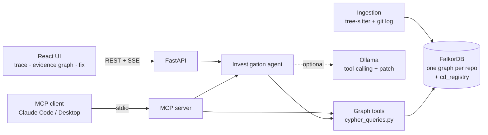

# Codebase Detective

**A bug-investigation agent that reasons over a FalkorDB code graph.** Paste a bug report (a stack trace helps) and
the agent walks the graph of your repository (functions, calls, tests, commits and the people who wrote them) to find
the root cause. It shows every hop as a Cypher query, then suggests a patch, reviewers, and what else the fix could break.
It remembers every investigation in the graph, so the next bug in the same area starts with that history.

Built for **Graph Hacks 2026** (WeMakeDevs × FalkorDB).

**Tracks entered:** Agents That Act on Connected Data (primary) · Agent Memory and Coordination

| What the brief asks for | Where it lives |
|---|---|
| Multi-hop reasoning | Callers/callees up to 3 hops, tests reached through calls, call paths, blast radius |
| Graph queries and algorithms as agent tools | 12 tools, all Cypher: PageRank hotspots, `shortestPath`, full-text search, BFS-style expansion |
| Tool selection through MCP | `backend/app/mcp_server.py` exposes the same tools (plus `investigate_bug`, `run_cypher`) to any MCP client |
| Actions based on what the graph shows | Ranks suspects, picks a root cause, writes a patch, names reviewers from commit authorship |
| Explainable results | Every step carries its Cypher; the **evidence graph** shows exactly the nodes and edges the agent visited |
| Memory across sessions | `Investigation` nodes linked to the functions they suspected or confirmed; recalled and scored by later runs |
| Shared state between agents | The web agent and an MCP client (e.g. Claude Code) read and write the same investigation memory |

## Why it needs a graph

"Why does refunding an unknown order crash?" isn't answered by any single record. The answer is a path:

```
(BugReport)-[:MENTIONS]->(handle_refund_request)-[:CALLS]->(process_refund)-[:CALLS]->(find_order)
(Person {Dana Kim})-[:AUTHORED]->(Commit "Refactor refund flow")-[:TOUCHED]->(process_refund)
(Test test_full_refund...)-[:TESTS]->(process_refund)        # happy path only
```

The agent follows those edges directly. If you remove FalkorDB, nothing is left: ingestion, every agent tool, scoring,
memory, the repository registry and the evidence graph are all Cypher over FalkorDB.

## Architecture



- **One graph per repository** (`repo_<uuid>`), plus a small `cd_registry` graph that lists repositories. This uses
  FalkorDB's multi-graph support: repos are fully isolated in one instance.
- **Ingestion** (`services/code_graph.py`, `services/parsing.py`): tree-sitter parses Python, JavaScript, TypeScript/TSX,
  Go and Java. Call sites are resolved to functions (same class → same file → imported file → unique name), tests are
  detected (`test_*`, `*.test.ts`, `it(...)` blocks, `*_test.go`, `@Test`), and `git log -U0` hunks are mapped onto
  function line spans. Everything is written in `UNWIND` batches.
- **Agent** (`services/agent.py`) works in two layers:
  1. A deterministic **graph sweep**: parse the report → locate entry points → expand along `CALLS` → gather evidence
     → rank. This always runs and needs no LLM.
  2. An optional **LLM loop** (Ollama, any tool-calling model): the model gets the ranked suspects and their source,
     picks graph tools itself to verify, and returns a verdict. A code model then writes a patch from the real source.

## Graph data model

### Nodes

| Label | Key properties | Notes |
|---|---|---|
| `Repository` | `id`, `name`, `url`, `ingested_at` | One per repo graph |
| `File` | `path`, `language`, `loc`, `is_test` | |
| `Class` | `id`, `name`, `file_path`, `start_line`, `end_line` | Also Go structs/interfaces, Java interfaces/enums |
| `Function` | `id`, `name`, `qualified_name`, `file_path`, `start_line`, `end_line`, `signature`, `doc`, `code`, `complexity`, `tokens`, `in_test_file` | `tokens` = split identifier + path words, full-text indexed |
| `Test` | `id`, `name`, `file_path`, `start_line`, `end_line`, `code` | Test functions and `it()/test()` cases |
| `Commit` | `sha`, `message`, `timestamp` (ms), `author` | Last 300 commits |
| `Person` | `email`, `name` | Commit authors |
| `BugReport` | `id`, `title`, `description`, `status`, `created_at` | **Memory** |
| `Investigation` | `id`, `title`, `status`, `summary`, `keywords`, `mode`, `payload` | **Memory**: full trace stored as JSON |

### Relationships

| Type | Pattern | Properties |
|---|---|---|
| `CONTAINS` | `(Repository)->(File)`, `(File)->(Function\|Class\|Test)` | |
| `HAS_METHOD` | `(Class)->(Function)` | |
| `CALLS` | `(Function)->(Function)` | `line`, `resolution`, `count` |
| `IMPORTS` | `(File)->(File)` | |
| `TESTS` | `(Test)->(Function)` | `line` |
| `MODIFIES` | `(Commit)->(File)` | `added`, `removed` |
| `TOUCHED` | `(Commit)->(Function)` | a diff hunk overlapped the function |
| `AUTHORED` | `(Person)->(Commit)` | |
| `MENTIONS` | `(BugReport)->(Function)` | entry points found for the report |
| `INVESTIGATED_IN` | `(BugReport)->(Investigation)` | |
| `SUSPECTS` | `(Investigation)->(Function)` | `rank`, `score` |
| `CONFIRMED` | `(Investigation)->(Function)` | human feedback: the real root cause |

### Indexes

```cypher
CREATE INDEX FOR (f:Function) ON (f.id)
CREATE INDEX FOR (f:Function) ON (f.name)
CREATE INDEX FOR (f:File) ON (f.path)
CREATE INDEX FOR (c:Commit) ON (c.sha)
CREATE INDEX FOR (p:Person) ON (p.email)
CREATE FULLTEXT INDEX FOR (f:Function) ON (f.tokens, f.doc)
CREATE FULLTEXT INDEX FOR (i:Investigation) ON (i.keywords_text, i.title)
```

## The Cypher the agent runs

All queries live in [`backend/app/services/cypher_queries.py`](backend/app/services/cypher_queries.py) and are
parameterized. The important ones:

**Locate: stack frame → function** (file suffix + name + line inside the body)
```cypher
MATCH (f:Function)
WHERE f.name = $name AND f.file_path ENDS WITH $file_suffix
  AND ($line < 0 OR (f.start_line <= $line AND f.end_line >= $line))
RETURN f.id AS id, f.qualified_name AS name, f.file_path AS file_path
```

**Locate: full-text over identifiers and docstrings**
```cypher
CALL db.idx.fulltext.queryNodes('Function', $q) YIELD node, score
WHERE node.in_test_file = false
RETURN node.id AS id, node.qualified_name AS name, score ORDER BY score DESC LIMIT $limit
```

**Multi-hop callers**
```cypher
MATCH p = (caller:Function)-[:CALLS*1..3]->(f:Function {id: $id})
WHERE length(p) <= $depth AND caller.id <> $id
WITH caller, min(length(p)) AS distance
RETURN caller.id AS id, caller.qualified_name AS name, distance ORDER BY distance
```

**Test coverage, direct and through callers**
```cypher
UNWIND $ids AS fid
MATCH (f:Function {id: fid})
OPTIONAL MATCH (t:Test)-[:TESTS]->(f)
OPTIONAL MATCH (ti:Test)-[:TESTS]->(:Function)-[:CALLS*1..2]->(f)
RETURN f.id AS id, collect(DISTINCT t.name) AS direct_tests, collect(DISTINCT ti.name) AS indirect_tests
```

**Who changed it recently**
```cypher
UNWIND $ids AS fid
MATCH (f:Function {id: fid})
OPTIONAL MATCH (p:Person)-[:AUTHORED]->(c:Commit)-[:TOUCHED]->(f)
WITH f, c, p ORDER BY c.timestamp DESC
RETURN f.id, collect({sha: c.sha, message: c.message, author: p.name})[0..$per_fn] AS commits
```

**Graph algorithm: PageRank over the call graph** (centrality factor + hotspots)
```cypher
CALL algo.pageRank('Function', 'CALLS') YIELD node, score
WITH collect({id: node.id, score: score}) AS all, max(score) AS top
UNWIND all AS row
WITH row, top WHERE row.id IN $ids
RETURN row.id AS id, row.score / top AS centrality
```

**Shortest call path**
```cypher
MATCH (a:Function {id: $src}), (b:Function {id: $dst})
WITH shortestPath((a)-[:CALLS*1..8]->(b)) AS p
RETURN [n IN nodes(p) | n.qualified_name] AS path
```

**Blast radius**
```cypher
MATCH (f:Function {id: $id})
OPTIONAL MATCH (caller:Function)-[:CALLS*1..4]->(f)
WITH f, collect(DISTINCT caller) AS callers
OPTIONAL MATCH (t:Test)-[:TESTS]->(x:Function) WHERE x = f OR x IN callers
RETURN size(callers) AS affected_functions, collect(DISTINCT t.name) AS covering_tests
```

**Expert routing (who knows this code)**
```cypher
MATCH (f:Function {id: $id})
OPTIONAL MATCH (p1:Person)-[:AUTHORED]->(:Commit)-[:TOUCHED]->(f)
OPTIONAL MATCH (p2:Person)-[:AUTHORED]->(:Commit)-[:MODIFIES]->(:File {path: f.file_path})
...
```

**Risky recent changes: untested functions touched by the last N commits, most-called first**
```cypher
MATCH (c:Commit)
WITH c ORDER BY c.timestamp DESC LIMIT $n
MATCH (p:Person)-[:AUTHORED]->(c)-[:TOUCHED]->(f:Function)
WHERE f.in_test_file = false
  AND NOT (:Test)-[:TESTS]->(f)
WITH f, collect(DISTINCT p.name) AS changed_by, collect(c.message) AS commits,
     max(c.timestamp) AS last_changed
OPTIONAL MATCH (caller:Function)-[:CALLS]->(f)
RETURN f.qualified_name AS function, f.file_path AS file,
       changed_by, commits, last_changed, count(DISTINCT caller) AS callers
ORDER BY callers DESC, last_changed DESC
```

**Memory: recall earlier investigations of these functions or their neighbours**
```cypher
UNWIND $ids AS fid
MATCH (f:Function {id: fid})
MATCH (i:Investigation)-[r:SUSPECTS|CONFIRMED]->(g:Function)
WHERE i.id <> $exclude AND (g = f OR (g)-[:CALLS]-(f))
MATCH (b:BugReport)-[:INVESTIGATED_IN]->(i)
RETURN f.id AS fn_id, g.qualified_name AS past_fn, type(r) AS relation, b.title AS bug_title, g = f AS same_function
```

### How suspects are scored

Every factor comes from the graph, and the UI shows the breakdown for each suspect:

```
score = 0.40·relevance      (stack frame 0.85–1.0, named 0.9, full-text ≤0.7, neighbours decay per hop)
      + 0.20·recent_change  (how recent the last TOUCHED commit is within the repo's history, squared)
      + 0.15·memory         (1.0 confirmed root cause before, 0.5 suspected before, 0.4 neighbour of a confirmed one)
      + 0.12·untested       (no TESTS edge 1.0, only reached through callers 0.5)
      + 0.08·complexity     (cyclomatic complexity from the AST, capped at 15)
      + 0.05·centrality     (PageRank on CALLS, normalised)
```

## Quick start (Docker)

Prerequisites: Docker. Optional: [Ollama](https://ollama.com) with a tool-calling model for the LLM layer and patches.

```bash
git clone <this repo> && cd codebase-detective
cp .env.example .env
python3 demo/create_demo_repo.py          # builds demo/acme-shop with a planted bug + git history
ollama pull qwen2.5-coder:7b              # optional; without it investigations run graph-only
docker compose up --build
```

- App: http://localhost:3000
- API docs: http://localhost:8000/docs
- FalkorDB Browser: http://localhost:3001 (connect to `falkordb:6379` from inside the stack, or `localhost:6379`)

Connect the demo repo with the path **`/demo/acme-shop`** (the compose file mounts `./demo`), or any public GitHub URL.

## Local development

```bash
docker run -d -p 6379:6379 -p 3001:3000 falkordb/falkordb:latest

cd backend
python3.11 -m venv venv && source venv/bin/activate
pip install -r requirements-dev.txt
cp ../.env.example .env
uvicorn app.main:app --reload            # http://localhost:8000
pytest                                   # 14 tests; integration tests need FalkorDB on :6379

cd ../frontend
npm install
npm run dev                              # http://localhost:3000 (proxies /api/v1 to :8000)
```

Set `LLM_PROVIDER=none` to run without any LLM. The graph sweep, ranking, verdict, reviewers and blast radius all
still work; you only lose the LLM tool loop and the patch.

## Use it from Claude Code (MCP)

`.mcp.json` in the repo root registers the MCP server, so opening this repo in Claude Code offers the tools
automatically. For other clients:

```json
{ "mcpServers": { "codebase-detective": {
    "command": "/abs/path/backend/venv/bin/python", "args": ["-m", "app.mcp_server"],
    "cwd": "/abs/path/backend", "env": { "FALKORDB_HOST": "localhost", "FALKORDB_PORT": "6379" } } } }
```

Tools: `list_repositories`, `search_code`, `get_function`, `get_callers`, `get_callees`, `get_tests`,
`recent_changes`, `find_experts`, `blast_radius`, `call_path`, `hotspots`, `risky_changes`, `recall_past_investigations`,
`investigate_bug`, `confirm_root_cause`, `run_cypher` (read-only).
Investigations started over MCP show up in the web UI's **Agent memory** panel and vice versa.

## Demo script (works with the bundled demo repo)

1. **Connect** `/demo/acme-shop` (Docker) or the absolute path to `demo/acme-shop` (local). Ingestion takes under a second:
   23 functions, 24 calls, 4 tests, 9 commits, 4 people.
2. **New investigation → "Fill demo bug"**: a 500 when refunding an unknown order, with a traceback.
3. **Watch the trace stream in**: 3/3 stack frames matched → callers and callees expanded → tests and commits gathered →
   PageRank → memory checked → ranked. Expand any step to see its Cypher.
4. **Verdict:** `process_refund`. It sits on the stack, it was changed most recently (Dana Kim's
   *"Refactor refund flow: … simplify order lookup"*, which switched to `find_order`, and that returns `None`), and its
   only test covers the happy path.
5. **Evidence graph tab**: the exact subgraph the agent traversed, with the root cause outlined in red.
6. **Fix tab**: patch (with Ollama), current source, reviewers (Dana Kim, Priya Raman) and blast radius.
7. **Suspects tab → "This is the root cause"** writes a `CONFIRMED` edge.
8. **Run a second, differently worded bug** ("Partial refund crashes for deleted orders", no stack trace). The memory
   step reports *"process_refund was the confirmed root cause of 'Refund of unknown order returns 500'"*, and its memory
   factor goes from 0 to 1.0.
9. Optionally ask Claude Code: *"Use codebase-detective to find who should review a change to process_refund"*. It
   calls `find_experts` over MCP.

## API

| Method | Path | |
|---|---|---|
| `POST` | `/api/v1/repos` | Connect a repo (`{name, url, branch?, github_token?}`); ingests in the background |
| `GET` | `/api/v1/repos` · `/api/v1/repos/{id}` · `/api/v1/repos/{id}/stats` | |
| `DELETE` | `/api/v1/repos/{id}` | Drops the repo graph |
| `POST` | `/api/v1/investigations` | Start (`{repository_id, title, description, use_llm}`) |
| `GET` | `/api/v1/investigations/{id}/events` | Server-sent events: each step as it happens, then the result |
| `GET` | `/api/v1/investigations/{id}` · `/api/v1/investigations?repository_id=` | |
| `POST` | `/api/v1/investigations/{id}/confirm` | Record the real root cause (`{function_id}`) |
| `GET` | `/api/v1/graph/investigation/{id}` | Evidence subgraph |
| `GET` | `/api/v1/graph/{repo_id}/hotspots` · `/risky-changes?commits=N` · `/function/{fid}` · `/function/{fid}/source` | |

## Project structure

```
backend/app/
  services/parsing.py         tree-sitter → functions, classes, tests, call sites, imports
  services/code_graph.py      ingestion pipeline, call resolution, git history, clone
  services/cypher_queries.py  every Cypher query
  services/graph_tools.py     agent tools (shared by the agent and MCP)
  services/agent.py           investigation pipeline, scoring, LLM loop, patch, memory
  services/llm.py             Ollama client (local or Ollama Cloud)
  services/store.py           repository registry graph
  api/routes/                 repos, investigations (+SSE), graph
  mcp_server.py               MCP server
frontend/src/
  pages/                      Dashboard, NewInvestigation, InvestigationView
  components/investigation/   EvidenceGraph (React Flow + dagre)
demo/create_demo_repo.py      synthetic demo repository with history
```

## Limitations

- Call resolution is static and name-based. Dynamic dispatch, decorators that wrap calls, and calls through variables
  can be missed, and a few ambiguous names are linked to up to two candidates (marked `resolution: ambiguous`).
- `TOUCHED` maps each commit's hunks onto today's function line spans, so it's accurate for recent commits and
  approximate for old ones.
- Re-connecting a repository rebuilds its graph, which clears that repository's investigation memory.
- Patches come from a local model and must be reviewed.

## Data

Only public repositories, or the synthetic `demo/acme-shop` repo (all names and emails are fictional), are used.

## AI assistance disclosure

This project was built with an AI coding assistant (Claude Code). <!-- Edit to describe exactly how you used it and
what you designed, verified and changed yourselves (rules 11–13). -->

## License

MIT
