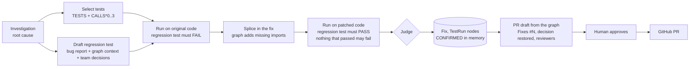

# Closing the loop: verify the fix, then ship it

An agent that only *suggests* a patch leaves the hardest part to a person: is the patch right, and what does it
break? GraphSleuth proves the fix in a sandbox first, using the code graph to decide what to run, and only
then drafts the pull request. A person still approves the PR before it's opened.



## 1. Test impact analysis on the graph

Running the whole suite is slow, and it doesn't tell you *which* tests matter. The graph already knows which tests
exercise the root cause, directly or through callers:

```cypher
MATCH (f:Function {id: $id})
MATCH p = (t:Test)-[:TESTS]->(:Function)-[:CALLS*0..3]->(f)
WITH t, min(length(p)) AS hops
RETURN t.id AS id, t.name AS name, t.file_path AS file_path, hops - 1 AS distance
ORDER BY distance, file_path, name
```

On the demo this selects **1 of 4** tests (`test_full_refund_marks_order_refunded`). The checkout and pricing tests
can't reach `process_refund`, so a change to it can't break them.

## 2. A regression test that reproduces the bug

A model drafts a pytest file from:
- the bug report,
- the root cause's code and module code,
- its callers and callees,
- the nearest existing tests,
- the **team decisions that govern the code**, from the company-brain graph.

On the demo that decision reads *"a missing order is an explicit OrderNotFound and never None"*, which is exactly what
the test should assert. The prompt also says the error in the report *is* the bug. Small models otherwise write
`pytest.raises(TypeError)`, a test that encodes the bug instead of the fix.

Without a model, a person (or an MCP client like Claude Code, through `verify_fix`) supplies the test. The UI
pre-fills a skeleton.

## 3. Before and after, in a sandbox

1. The repository is copied into a throwaway directory. If it was connected from a URL, it's shallow-cloned.
2. The regression test and the selected tests run on the **original** code. The regression test should fail: that
   proves it reproduces the bug.
3. The corrected function is spliced in. The splice uses the line span the graph stored for the function, and falls
   back to finding its exact source if the file has moved.
4. **Import repair.** A patch rewrites only one function, so it often uses a name the file never imports (the demo fix
   needs `get_order`). The sandbox parses the patched file with `ast`, finds names that are read but never defined,
   and asks the graph where each one is defined:
   ```cypher
   MATCH (n) WHERE (n:Function OR n:Class) AND n.name IN $names AND n.file_path ENDS WITH '.py'
     AND NOT n.file_path CONTAINS 'test' AND (n:Class OR n.qualified_name = n.name)
   RETURN n.name AS name, n.file_path AS file_path
   ```
   It prefers a module the file already imports from, and extends that import line.
5. The patched file must parse, then the same tests run again.

## 4. The verdict

| Status | Meaning |
|---|---|
| `verified` | The regression test failed on the original code and passes with the fix, and every selected test that passed before still passes |
| `regresses` | A selected test that passed before fails with the fix |
| `not_fixed` | The regression test reproduces the bug but still fails with the fix |
| `not_reproduced` | The regression test already passes on the original code: it doesn't capture the bug, so the fix is unproven |
| `no_regressions` | No regression test was supplied; the selected tests still pass, but nothing shows the bug is fixed |
| `error` | Collection errors, a timeout, or no tests ran |

Only `verified` counts as proof. The others are reported plainly, for example *"broke test_full_refund_marks_order_refunded"*.

## 5. Written back to the graph

```
(Investigation)-[:PROPOSED]->(Fix {status, payload})-[:PATCHES]->(Function)
(Fix)-[:VERIFIED_BY {phase: 'original'|'patched'}]->(TestRun {passed, failed, errors, duration_ms})
(TestRun)-[:RAN {outcome}]->(Test)
(Fix)-[:OPENED_AS]->(PullRequest)            # after a person approves
```

A `verified` fix also writes `(Investigation)-[:CONFIRMED {source: 'verification'}]->(Function)`. The next
investigation that touches this code recalls it with the same weight as a human confirmation. A failed attempt stays
in the graph too, as a `Fix` with its status, so the team can see what didn't work.

## 6. The pull request, written from the graph

Every line of the description comes from a node:

- **Root cause:** the verdict and its graph evidence.
- **Decision this restores:** a `Decision` whose code changed later (drift), with the PR that reversed it.
- **Proof:** the before/after table from the two `TestRun`s, and how many tests the graph selected.
- **Blast radius:** callers, from `CALLS`.
- **Suggested reviewers:** CODEOWNERS team members and authors, with GitHub logins from `Person.login`.
- **`Fixes #13`:** open issues that mention the root cause.

`POST /investigations/{id}/fixes/{fix_id}/pull-request` does the following:
- It refuses unless the body has `approve: true`.
- It creates the branch from the commit the fix was verified against.
- It commits the patched file and the regression test.
- It opens the PR, as a **draft** unless the fix is verified.
- It requests the reviewers.

For a repository connected from a directory (the demo), there's no GitHub remote. The UI offers the fix as a
`.patch` that applies with `git am` instead.

## Safety boundaries

Running a repository's tests runs its code, so:

| Control | What it does |
|---|---|
| `VERIFY_FIXES=local` (default) | Only repositories connected from a server directory, which the operator put there, can be verified. `all` also clones and runs GitHub repositories; use it only where the API runs in a disposable container. `off` disables verification |
| Scrubbed environment | The test process gets `PATH`, a sandbox `HOME`/`TMPDIR` and `PYTHONPATH`, nothing else: no FalkorDB, GitHub or LLM credentials |
| Resource limits | `RLIMIT_CPU` = timeout, 64 MB max file size, no core dumps, and `RLIMIT_AS` (`VERIFY_MEMORY_MB`) on Linux |
| Timeout | `VERIFY_TIMEOUT_SECONDS` (60 by default); the whole process group is killed |
| Isolation of plugins | `PYTEST_DISABLE_PLUGIN_AUTOLOAD=1`, so the API's own pytest plugins don't change how the repository's tests run |
| Path checks | Every file the sandbox writes is checked to stay inside the copy |
| Concurrency | At most two verifications at once per server |
| Human gate | The agent never opens a PR by itself; the API requires `approve: true` for one specific fix id |

What it doesn't do: the child process runs as the same OS user as the API. On Linux, that user can read
`/proc/<pid>/environ` of the API process. The scrubbed environment protects against accidental leaks, not against
hostile code. That's why `local` is the default and the hosted demo only verifies the bundled repository. Hostile code
needs a container or VM per run (gVisor, Firecracker, or a hosted sandbox), which the free Render plan can't start.

## Limits

- Python repositories with pytest only. The selection query is language-neutral, but the runner isn't.
- The repository's third-party dependencies aren't installed in the sandbox. Tests that import them fail at
  collection, and the run is reported as `error`, not as a verdict on the fix.
- The patch replaces one function (plus the imports it needs). Fixes that span several functions can be sent as a
  unified diff through the API (`diff`), which `git apply` applies.
